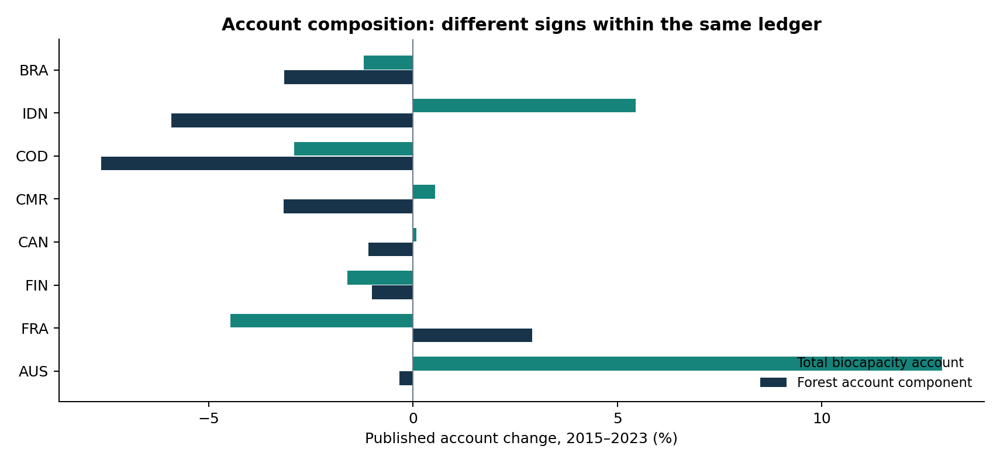
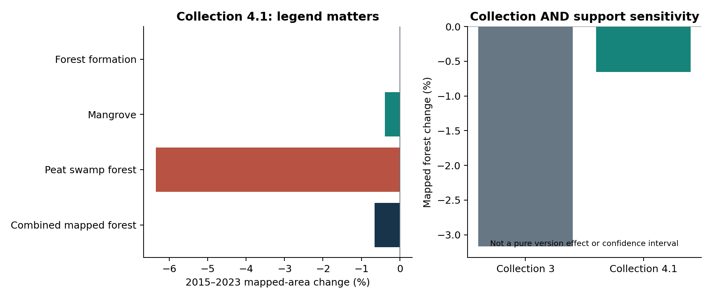
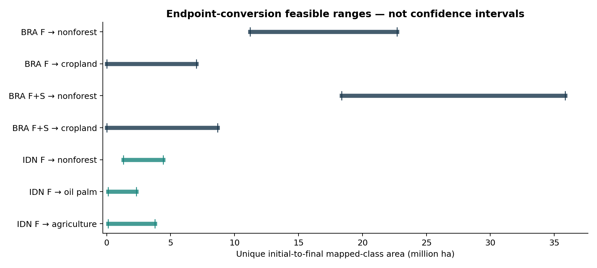
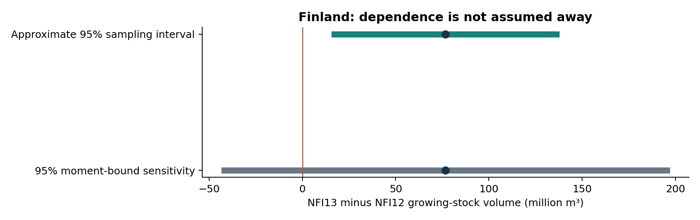

# National account composition, mapped forest extent and inventory-cycle stock change

## An empirical extension with conditional conversion bounds

Amin Abaee · Independent Researcher, Tehran, Iran · ORCID: https://orcid.org/0000-0002-0019-1842

30 October 2026 · F12_A01 · Additive empirical extension; the earlier manuscript remains unchanged.

## Abstract

An aggregate biocapacity account and a physical ecological asset need not move together, but an empirical comparison must identify its quantities, temporal operators and uncertainty. We compute 2015–2023 account changes for all 183 eligible identifiers in the 2026 national accounts, complete national MapBiomas extent and transition analyses for Brazil and Indonesia, and official Finnish inventory-cycle biomass and volume summaries. Total biocapacity increases in 91 identifiers and decreases in 92; 68 of the increasing totals coexist with a declining forest account component. Indonesia combines a 5.46% total-account increase with a 0.66% decline in Collection 4.1 mapped forest extent. Brazil instead has both a decreasing total account and decreasing mapped formations. A layered marked-flow model constrains unique endpoint conversions without equating repeated annual events with unique hectares. Its geographically refined Indonesia forest-to-oil-palm range is approximately 0.112–2.326 million hectares, conditional on the published classifications. Finnish growing-stock volume increases by 76.772 million cubic metres between NFI12 and NFI13; an approximate 95% Bonferroni interval remains positive without assuming cross-inventory independence. These are substantive national results, but neither mapped extent nor inventory-cycle volume establishes a calibrated 2015–2023 national above-ground biomass change. Reporting should preserve those evidential distinctions rather than erase the new evidence or promote it to a different target.

Keywords: Biocapacity; natural capital accounting; forest extent; national forest inventory; land-use change; partial identification; uncertainty.

## 1. Questions and estimands

The empirical question is whether an improving account can coexist with loss in a specified ecological asset, and what the evidence establishes about conversion and spatial compensation. Three quantities are kept distinct: published biocapacity in global hectares (gha); areas assigned to operational mapped land-cover classes in hectares; and inventory growing-stock volume in cubic metres or biomass dry mass in tonnes. None is a universal index of ecological condition. A forest plantation, natural forest, temporarily unstocked forest and an annual mapped formation may belong to different reporting categories.

The primary national above-ground biomass target retains its 2015 and 2023 endpoints and common-support requirements. National mapped-cover comparisons and Finnish inventory-cycle inference are additional, explicitly typed analyses, not replacements for that target. The eight inherited candidates remain Brazil, Indonesia, the Democratic Republic of the Congo, Cameroon, Canada, Finland, France and Australia. They are a logistical case set, not a probability sample. Source feasibility and prior country accounts or published trend headlines were known during this exploratory extension; no untouched held-out or outcome-naive selection is claimed.

## 2. Data and methods

### 2.1. Accounts, eligibility and composition

The 2026 national workbook supplies 13,652 country-year rows and 236 identifiers. The inherited availability rules admit 183 identifiers with all annual records in 2015–2023, allowed publication flags, positive population, nonnegative required quantities and numerical component consistency. We calculate actual endpoint changes, all five component contributions, total-minus-fishing, total-minus-built, total-minus-both and per-person sensitivities. The inherited 2010–2020 secondary window is also executed for 182 comparable members of the same primary cohort; South Sudan lacks an admissible 2010 endpoint. The additional 2015–2022 sensitivity does not supersede that secondary window. [1]

For component k, its contribution in percentage points of the initial total is 100(B_k,2023 − B_k,2015)/B_total,2015. A decline in the forest account component is an account result, not an independently measured forest loss. For forest gha = area × accounting factor, the symmetric decomposition is ΔB_f = ΔA(f_0+f_1)/2 + Δf(A_0+A_1)/2. The implied gha/ha factor is not interpreted as physical forest yield or condition. Component-sum tolerances account only for rounding.

### 2.2. Complete provider tables, not extrapolated local windows

Brazil uses the complete official Collection 11 biome-state workbook: 960 leaf-class geographic rows, 27 states, six biomes and an approximately 850.645-million-hectare reported footprint. Both endpoints and all eight consecutive annual transition intervals come from the same collection. The formations group F comprises Forest Formation (3), Mangrove (5), Floodable Forest (6) and Wooded Sandbank Vegetation (49). A distinct F+S grouping additionally includes Savanna Formation (4) and Flooded Savanna (7). Plantations (9) remain separate. Published crop subclasses, pasture and mosaics are retained as distinct destinations. [2]

Indonesia uses the complete Collection 4.1 workbook: 441 leaf-class province rows, 38 provinces, seven island groups and an approximately 189.044-million-hectare reported footprint. Its official mapped Forest group comprises Forest Formation (3), Mangrove (5) and Peat Swamp Forest (76). Oil palm (35) and pulpwood plantations (9) are agricultural classes, not members of this forest group. The comparison also examines the earlier Collection 3 table, excluding its separately labelled 20-kilometre island-buffer category. Collection 3 and 4.1 have different reported geographic support, so their contrast is a collection-and-support sensitivity, not a clean version effect. [3,4]

Leaf classes are summed only once. Annual transition row and column margins are checked against the corresponding coverage areas at the finest reported geographic/class level. Forest inflow minus outflow is reconciled with each annual extent change. Maximum margin residuals are below 0.000005 ha in Brazil and 0.0000003 ha in Indonesia; these are numerical consistency checks, not accuracy estimates. Complete provider partitions do not certify exact equivalence to every national-account component's territorial convention. Zero tabulated no-data area also does not establish cloud-free observation: gap filling and temporal filtering can assign complete labels.

### 2.3. Unique endpoint conversions from annual aggregate capacities

Annual outflows count transition events, including land that changes more than once. They are not unique 2015-to-2023 forest conversion hectares. To learn more without inventing pixel trajectories, we construct a layered network with class nodes for each year and observed annual class-to-class area T_(t,i,j) as edge capacity. A marked flow x_(t,i,j) represents land mapped as forest in 2015. On the first transition x = T for forest-origin edges and x = 0 otherwise. At every interior class-year node, marked inflow equals marked outflow, with 0 ≤ x ≤ T. Minimizing and maximizing marked inflow into a specified 2023 target class gives its feasible endpoint-conversion range.

These bounds are sharp for the ideal balanced, continuous-area aggregate-capacity model: every feasible marked flow, and its unmarked complement, can be decomposed into paths on the acyclic network. Conversely, any pixel history consistent with the aggregate matrices induces such a feasible flow. The calculation therefore bounds endpoint cohort areas without claiming to recover the actual histories. Source rounding and numerical tolerances are recorded separately. Solving within fixed reported geographic units and summing their extrema restricts cross-region rearrangements and cannot weaken the raw bounds. We evaluate national aggregation and 49 Brazilian state-biome intersections or 38 Indonesian provinces, yielding 634 linear programmes. Saved primal and dual witnesses are independently checked from the deposited capacities, without re-solving.

The target is land mapped as F in 2015 and, for example, oil palm in 2023; it can pass through intermediate classes and can experience repeated conversion. This is not necessarily a single direct forest-to-oil-palm event. It is not first clearing, a calibrated true transition, converted biomass or a causal effect.

### 2.4. Error requirements and covariance-independent inventory inference

If each mapped endpoint area has absolute area error bounded by e, the true area difference lies within mapped ΔA ± 2e. A sign ceases to be guaranteed at e = |ΔA|/2. These break-even requirements are conditional sensitivity results, not measured uncertainty intervals. For an endpoint-conversion intersection, the appropriate errors are instead symmetric differences of the initial forest and final destination class sets. If their area-error budgets sum to E, a mapped lower conversion bound L implies a reference-defined lower bound no smaller than max(0,L−E). A bound on net class area alone does not supply this class-set error budget.

Finnish NFI12 (2014–2018) and NFI13 (2019–2023) refer to productive and poorly productive forest across the whole country, including Åland. The national APIs supply biomass components, volume and area; the original inventory supplementary tables supply volume standard errors. These inventory cycles are not relabelled exact 2015 and 2023 observations. [6,7]

For two marginal approximately normal inventory estimators with standard errors s_0 and s_1, form two-sided 97.5% endpoint intervals. Bonferroni's union bound gives at least approximately 95% simultaneous endpoint coverage without assuming independence or a particular joint distribution. Subtracting the endpoints gives ΔV ± z_0.9875(s_0+s_1), where z_0.9875 = 2.241403. A small outward allowance covers published point/SE rounding. This addresses sampling uncertainty under marginal normal approximation, not unbounded differential measurement or model bias. Separately, the sensitivity ΔV ± √20(s_0+s_1) uses a worst-covariance second-moment bound, conditional on unbiased errors and treating the reported standard errors as true error standard deviations. Its stronger distribution-free interpretation is not asserted for estimated variances.

## 3. Results

### 3.1. Actual account trajectories and domain dependence

Total account biocapacity increases in 91 of the 183 eligible identifiers and decreases in 92. Of the increasing totals, 68 coexist with a declining forest account component, 22 with an increasing component and one with a component change unresolved at the rounding scale. This is within-account composition, not a count of ecological asset losses. All eight inherited candidates are retained in Table 1.

Table 1. Actual 2015–2023 percentage changes. “− both” excludes fishing and built components; forest is the account component, not mapped area or physical biomass. Per-person results are separate quantities.

| ISO3 | Total | − fishing | − built | − both | Forest account | Per person |
| --- | --- | --- | --- | --- | --- | --- |
| BRA | -1.21 | -1.24 | -1.34 | -1.37 | -3.15 | -5.64 |
| IDN | +5.46 | +7.57 | +4.64 | +6.68 | -5.92 | -1.82 |
| COD | -2.91 | -2.96 | -3.36 | -3.42 | -7.64 | -25.63 |
| CMR | +0.54 | +0.55 | -0.22 | -0.24 | -3.16 | -19.34 |
| CAN | +0.08 | -1.41 | +0.06 | -1.44 | -1.10 | -8.41 |
| FIN | -1.60 | -2.03 | -1.54 | -1.96 | -1.01 | -3.74 |
| FRA | -4.47 | -4.67 | -4.53 | -4.75 | +2.91 | -6.66 |
| AUS | +12.95 | +17.30 | +12.53 | +16.78 | -0.33 | +2.26 |

Cameroon's total-account sign changes when built area is excluded; Canada's changes when fishing is excluded. Indonesia remains increasing under all three exclusions, although its per-person total declines. Brazil's total decreases, so it does not exemplify an increasing aggregate account concealing loss. The candidate set is not reduced to the cases with the desired direction.

### 3.2. National mapped forest extent

Brazil's formations decline from 412.016 to 401.154 million hectares: −10.863 million hectares, or −2.64%. The broader formations-plus-savanna group declines by 18.184 million hectares (−3.43%). Brazil's total biocapacity declines by 1.21%. The two negative signs do not establish equality of ecological condition, but they contradict an increasing-total narrative for this country and window.

Indonesia's Collection 4.1 mapped forest declines from 107.055 to 106.352 million hectares: −702,562 ha, or −0.66%, while total biocapacity increases by 5.46%. Excluding fishing gives +7.57%; excluding fishing and built gives +6.68%. This is a nominal national account–mapped-extent discordance, not yet a calibrated national biomass loss. The combined forest result is definition-sensitive: Forest Formation alone increases by 3,019 ha (+0.0032%), mangrove decreases by 11,620 ha, and peat swamp forest decreases by 693,961 ha (−6.35%). Class components describe the classification, not identified physical causes.

Collection 3 reports a larger Indonesian forest decline of 3.106 million hectares (−3.17%) over the same endpoint years. Its retained all-class footprint exceeds the Collection 4.1 reported footprint by 43,130 ha, but that difference in total area is not a bound on their geometric symmetric difference. The 2.403-million-hectare difference between reported net forest changes cannot therefore be attributed solely to version processing. Both collections give a negative combined forest change, but they differ materially in levels and magnitude.

### 3.3. Gross mapped events, spatial compensation and endpoint bounds

Brazilian formations have 22.711 million hectare-events of annual outflow and 11.848 million hectare-events of annual inflow. Their difference matches the −10.863-million-hectare endpoint change. Indonesian forest has 4.424 million hectare-events of outflow and 3.722 million hectare-events of inflow, matching the −0.703-million-hectare net change. Summing repeated-year event areas is not a unique land-area estimate.

Across Indonesia's provinces, the sum of negative province-level net changes is 1.303 million hectares and the sum of positive province-level net changes is 0.601 million hectares. Spatially aggregated net change therefore omits substantial classified regional compensation. These are descriptive map quantities, not confidence-resolved regional losses and gains.

Table 2. Conditional unique 2015-to-2023 mapped endpoint-cohort ranges using the finest reported geographic constraints. F denotes each country's stated forest/formation group; F+S denotes Brazilian formations plus savannas. Displayed endpoints are rounded; full-precision data include outward numerical allowances. These are feasible ranges, not confidence intervals.

| Country / initial group | 2023 target | Lower (Mha) | Upper (Mha) |
| --- | --- | --- | --- |
| BRA / F | nonforest | 11.2037 | 22.7108 |
| BRA / F | cropland | 0.0000 | 7.0144 |
| BRA / F+S | nonforest | 18.3738 | 35.8473 |
| BRA / F+S | cropland | 0.0094 | 8.6617 |
| IDN / F | nonforest | 1.3120 | 4.4241 |
| IDN / F | oil palm | 0.1116 | 2.3258 |
| IDN / F | agriculture | 0.1268 | 3.7636 |

Indonesia's mapped 2015-forest-to-2023-oil-palm area is bounded below by about 111,612 ha and above by about 2.326 million ha. The lower bound remains positive in the classified aggregate model despite allowing every compatible intervening path. The range is not the 707,004 hectare-events of direct annual forest-to-oil-palm transitions: endpoint cohorts can pass through other classes. Brazil's formations-to-cropland lower bound is zero, whereas the formations-plus-savanna-to-cropland lower bound is about 9,386 ha. Thus the annual tables support some geographically constrained endpoint statements but do not identify all proposed conversion mechanisms or remove dependence on the forest definition.

### 3.4. Finland: a supported secondary volume result

The national inventory API reports total living-tree biomass of 1,744 and 1,786 million tonnes for NFI12 and NFI13, respectively. This includes stumps and roots. The sum of published stems plus branches/foliage is 1,350 and 1,384 million tonnes; independently rounded components can differ from the published total by approximately one million tonnes. Neither series is silently equated with the primary remote-sensing above-ground biomass definition, and the API table supplies no marginal biomass standard errors.

The original volume/SE cells give 2,475.192 ± 13.001 million m³ for NFI12 and 2,551.964 ± 13.534 million m³ for NFI13, where ± denotes one reported sampling standard error, not a 95% interval. The difference is +76.772 million m³ (+3.10%). The approximate 95% simultaneous-endpoint Bonferroni difference interval is [17.3, 136.3] million m³, including the conservative source-rounding allowance. Cross-cycle independence is not assumed. A differential-bias budget of approximately 17.3 million m³ would exhaust the positive lower sampling bound; that bias budget has not been independently measured.

The second-moment sensitivity interval is [-41.9, 195.4] million m³ and does not resolve the sign. The positive conclusion is consequently an approximate design-based sampling result for the two inventory cycles, not an assumption-free statement about total error or an exact 2015–2023 biomass result. Geographic inclusion of Åland is established for these inventory tables, while equivalence to every account component's territorial convention remains a separate question.

Official forest-account timber stocks provide a further warning about temporal and accounting operators. In 2023, opening-to-closing reported volume falls by 4.185 million m³ even though net increment minus removals is +20.802 million m³, because the balancing item is −24.987 million m³. Reclassification is zero and the reconciliation closes. This shorter-window, partly inventory-derived forest account is neither an independent biomass validation nor proof of observed ecological loss from the negative closing-stock difference. [8]

## 4. Validation limits are quantitative requirements, not blanket exclusions

For Brazil's formations, symmetric endpoint absolute-area errors must each be smaller than 5.431 million ha to guarantee the negative net sign under that bound; this is 0.6385% of the tabulated national footprint per endpoint. For Indonesia's combined forest, the corresponding requirement is 351,281 ha, or 0.1858% of its footprint per endpoint. No measured endpoint error budget satisfying either requirement is claimed.

The Indonesian forest-to-oil-palm lower endpoint bound requires a different calibration: the combined initial-forest and final-oil-palm class-set symmetric-difference error budget must be below about 111,612 ha to retain a positive reference-defined lower bound. Equal endpoint allocations would be about 55,806 ha each, or 0.0295% of the reported footprint. A pooled or incompatible overall accuracy percentage, or even a small error in net class area, does not provide that set-error guarantee.

The current Brazilian Collection 11 accuracy appendix describes reference collection 3 for 1985–2024, with boundary-point exclusions, interpreter-agreement weighting, sparse-class exclusions and map-dependent legend harmonization. The public collection-2.1 point representation examined here is not that same reference vintage. Of its 85,152 points, 4,053 have nonblank 2015 and 2023 labels, 4,041 remain after excluding non-observed labels and the archive's training role, and 3,042 are also nonedge at both endpoints. Their geographic distribution is highly uneven; nonblank labels alone do not establish national representativeness or compatibility. The old archive's 9,999 training tokens also differ from the newer document's stated 10,000 training points, which is retained as a provenance discrepancy rather than silently reconciled. [5]

Indonesia's current Collection 4.1 ATBD lists no global accuracy estimate for that collection in its collection summary. The described independent annual reference labels cover 2000–2022, and the public accuracy page describes Collection 2.0. These facts do not show that newer validation is impossible or nonexistent; they show why the acquired documentation and earlier pooled accuracies cannot certify the 2015–2023 Collection 4.1 change. Marginal reference-based endpoint intervals can suffice: exact paired censuses and known covariance are not mandatory if compatible designs yield adequate simultaneous bounds. [4]

## 5. Implications and remaining empirical questions

The results establish actual national account changes, national published-map extent dynamics and conditional conversion ranges for two countries, plus a defensible secondary inventory-cycle volume result. They no longer support treating all national evidence as absent. Equally, they do not establish any of the eight original calibrated national 2015–2023 above-ground biomass changes. The Democratic Republic of the Congo, Cameroon, Canada, France and Australia have not received completed physical national analyses in this extension; that is unfinished work, not a demonstrated permanent lack of suitable evidence.

No conversion association, causal conversion effect, or reporting false-negative rate against independently supported ecological outcomes is estimated. Repeating a single national account change as if it supplied independent state-level observations would not solve that problem. The two processed map cases are also not a representative country sample. The nominal Indonesian discordance and Brazilian concordance are retained together, without promoting their one-of-two pattern into population accuracy.

A useful reporting sidecar would present the aggregate account with its components and domain sensitivities; a separately defined physical extent or stock; a source-appropriate uncertainty or feasible set; and conversion diagnostics that distinguish repeated events from unique endpoint cohorts. Such a sidecar supplies information but does not by itself demonstrate improved reporting accuracy. That claim requires independent reference outcomes on common cases. The useful distinction is not a choice between accounts and assets, but a requirement to show both and identify the evidential status of each.

## Data, methods and assistance

Machine-readable results, source URLs and SHA-256 identities, original figures, analysis code, compressed annual transition capacities and saved primal/dual witnesses accompany this extension. Provider workbook and PDF bodies are not redistributed. The workbook national_results_F12_A01.xlsx supplies directly readable result tables and definitions. The separate completion account documents executed dependencies and unfinished work; it is not evidence of ecological validation.

Arena.ai Agent Mode was used to assist with computational methods and literature review.

## References

[1] Footprint Data Foundation and Global Footprint Network. National Ecological Footprint and Biocapacity Accounts, 2026 edition, results and metadata v1.0. Exact workbook identity is supplied in the source metadata. https://data.footprintnetwork.org/

[2] MapBiomas Brazil. Collection 11 national coverage and transition statistics, biome-state workbook, accessed 30 October 2026. https://brasil.mapbiomas.org/iniciativas-e-produtos/cobertura-e-uso-da-terra/cobertura-30m/cobertura/

[3] MapBiomas Indonesia. Collection 4.1 and Collection 3 land-cover statistics, accessed 30 October 2026. https://landy.mapbiomas.id/en/statistics

[4] MapBiomas Indonesia. Algorithm Theoretical Basis Document, Collection 4.1, February 2026, especially pp. 5, 12 and 28–29; and public accuracy-assessment page. https://landy.mapbiomas.id/en/atbd and https://landy.mapbiomas.id/en/accuracy-assessment

[5] MapBiomas Brazil. Accuracy Assessment Appendix, Collection 11 v1, sections 2.2.3–2.2.4; public reference-point downloads. https://brasil.mapbiomas.org/downloads/pontos-de-validacao/

[6] Korhonen, K.T., Ahola, A., et al. (2021). Forests of Finland 2014–2018 and their development 1921–2018. Silva Fennica 55, article 10662. Supplementary S2, Table 20a. https://doi.org/10.14214/sf.10662

[7] Korhonen, K.T., et al. (2024). Forests of Finland 2019–2023 and their development 1921–2023. Silva Fennica 58, article 24045. Supplementary S2, Table 55. https://doi.org/10.14214/sf.24045

[8] Natural Resources Institute Finland (Luke). Archived forest resources statistics and forest accounts, national inventory biomass/volume/area and 2022–2023 timber-stock tables. API queries and returned data are deposited. https://www.luke.fi/en/statistics/forest-resources
