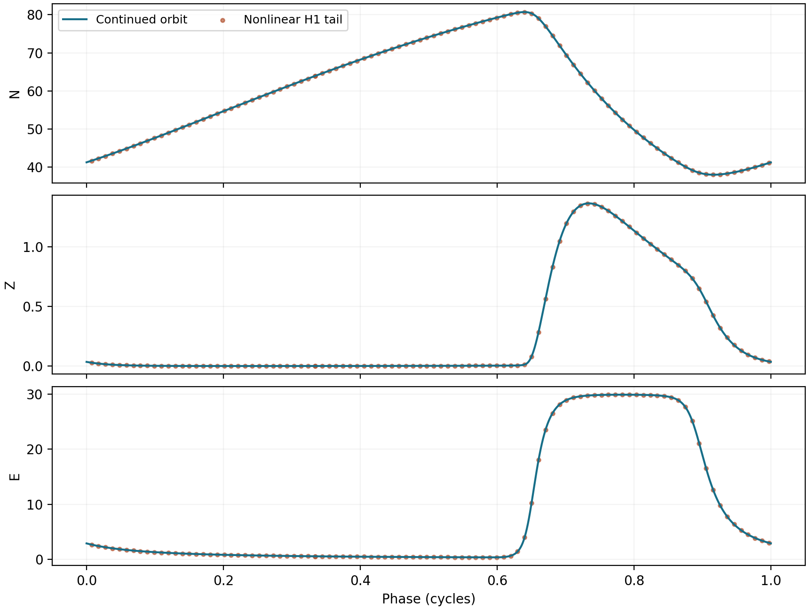

## S13. Verified nonlinear Hopf coefficients

### S13.1 Derivatives of the declared retarded equation

Write $D(N,E)=qEN-rN(1-N/K)$ and $\Phi_\kappa(D)=\log(1+e^{\kappa D})/\kappa$. At an interior steady state $D=0$, $Z=\delta$, so $\Phi'=1/2$, $\Phi''=\kappa/4$, and $\Phi'''=0$. Use extended directions $u=(u_N,u_Z,u_E,u_\zeta)$, where $\zeta$ is the delayed memory argument. Then
$$D_1(u)=(qE^*-r+2rN^*/K)u_N+qN^*u_E,$$
$$D_2(u,v)=2r u_Nv_N/K+q(u_Nv_E+u_Ev_N).$$
For $f=(f_1,f_2,f_3)$, define $B=D^2f$ and $C=D^3f$, without factorials. Their ecological components are
$$B_1=-D_2,\quad C_1=0,\quad B_2(u,v)=\frac{D_2(u,v)/2+\kappa D_1(u)D_1(v)/4}{\tau_m},$$
$$C_2(u,v,w)=\frac{\kappa}{4\tau_m}\big[D_2(u,v)D_1(w)+D_2(u,w)D_1(v)+D_2(v,w)D_1(u)\big].$$
At the registered unit references, put $M=E_{\max}$ and $g=1-E^*/M$. The nonzero gated effort derivatives are
$$f_{EE}=-2\eta(1+\delta)/M+6\eta E^*/M^2,\quad f_{E\zeta}=\eta-2\eta E^*/M-\delta_0/[M(1+\delta)^2],$$
$$f_{\zeta\zeta}=-2\delta_0g/(1+\delta)^3,\quad f_{EEE}=6\eta/M^2,\quad f_{EE\zeta}=-2\eta/M,$$
$$f_{E\zeta\zeta}=2\delta_0/[M(1+\delta)^3],\qquad f_{\zeta\zeta\zeta}=6\delta_0g/(1+\delta)^4.$$
These entries and symmetry determine $B_3,C_3$. Without the outer gate, $f_{EE}=-2\eta/M$, $f_{E\zeta}=\eta$, $f_{\zeta\zeta}=-2\delta_0/(1+\delta)^3$ and $f_{\zeta\zeta\zeta}=6\delta_0/(1+\delta)^4$; the other effort third derivatives vanish.

### S13.2 RFDE homological formula and convention

Let $A_0,A_1$ be the instantaneous and delayed Jacobians and $\mathcal D(s)=sI-A_0-A_1e^{-s\tau}$. At $\lambda=i\omega$, choose $\|v\|_2=1$ and the complex left row $p$ so that $p\mathcal D(\lambda)=0$ and $p\mathcal D'(\lambda)v=1$. A mode $h$ at frequency $s$ is lifted to $L_s h=(h_N,h_Z,h_E,e^{-s\tau}h_Z)$. Set $V=L_\lambda v$ and
$$h_{20}=\mathcal D(2\lambda)^{-1}B(V,V),\qquad h_{11}=\mathcal D(0)^{-1}B(V,\overline V),$$
$$G_{21}=p\big[C(V,V,\overline V)+B(\overline V,L_{2\lambda}h_{20})+2B(V,L_0h_{11})\big].$$
The physical-time coefficient is $\ell_1=\operatorname{Re}G_{21}/2$. In a unit-frequency time convention it is divided by $\omega$. This positive conversion does not change criticality. Only the right vector has unit Hermitian norm; normalizing both vectors independently would generally violate the required adjoint pairing.

For gated A, the physical-time coefficients are $5.74790328\times10^{-5}$ and $3.54919608\times10^{-4}$, both interval-positive. The real eigenvalue crossing derivatives have opposite strict signs, approximately $-9.48314396\times10^{-5}$ and $5.50936083\times10^{-6}$. Interval bounds exclude zero from $|\partial_\lambda\Delta|^2$, $\Delta(0)$ and the second-harmonic resolvent. The cubic has precisely two positive roots; the remaining root is negative. The first recurrence of the lower-frequency family lies beyond $253$ yr and hence beyond the upper fundamental crossing. There is therefore no additional imaginary family at either point. These facts establish the classical smooth-retarded-equation Hopf hypotheses and the two subcritical local branches. They do not construct a finite branch-radius enclosure.

For ungated B, the corresponding coefficients are approximately $-9.84424\times10^{-5}$ and $2.18520\times10^{-3}$. The same interval simplicity, transversality, resolvent and recurrence tests verify their negative/positive signs, yielding the supercritical lower and subcritical upper crossing. The all-variant scalar table below does not assert nonlinear cubic certification for the other two gating combinations.

The scripts `hopf_cubic_v42.py` and `all_scalar_hopf_v42.py` use `mpmath.iv` at 70 and 80 decimal digits with exact decimal parameter strings and outward-serialized endpoints. High-precision automatic directional differentiation of the original nonlinear formulas agrees with the analytic $B,C$ derivatives to less than $3.5\times10^{-84}$. Full intervals are in `hopf_cubic_interval_v42.json` and `hopf_cubic_B_interval_v42.json`. No radii-polynomial Hopf neighbourhood or continuum fold lift is asserted.

SCALAR_TABLE_PLACEHOLDER

## S14. Protective review margins and nonlinear viability

For $a=-A_N>0$, the ecological effort-to-memory impulse response is $g(t)=B_E(de^{-dt}-ae^{-at})/(d-a)$. Its single sign change occurs at $t_0=\log(d/a)/(d-a)$. Integrating its positive and negative parts gives
$$\|g\|_1=\frac{2B_E}{d}(a/d)^{a/(d-a)}\le2B_E/d=qN^*.$$
At $a=d$ the continuous limit is $2B_E/(ae)$. The protective effort-filter gain is $k/c=E^*/(Z_{\rm ref}+\delta)$, independent of $\eta_p>0$. Their product is enclosed near $0.1380266770<1$ at Candidate A. Weighted continuous/discrete small gain proves the exact/native all-cadences statements of Theorem 7.2. Each cadence and latency is fixed and finite; the theorem does not assert a uniform exponential rate as they tend to infinity.

The $\theta$-review recursion has gain $k/c$ when its scalar multiplier is nonnegative. When that multiplier is negative, its gain is $kT_r/[2+(2\theta-1)cT_r]$, bounded by $k/[c(2\theta-1)]$. Thus $\theta>0.569014$ suffices at the point vector; $\theta\ge0.57$ is a conservative decimal choice. Explicit Euler is outside this unconditional range. Across the main-text mathematical parameter box, the conservative gain bound is less than $0.274$, so exact/native review and $\theta\ge0.64$ review are certified. The $0.57$ value is not claimed uniformly over that whole box.

For nonlinear safety, the quota bound $C(Z)\le E_0$ and positive effort-relaxation factor make $E\le E_0$ invariant when the initial effort lies below it. Scalar logistic comparison gives, more generally,
$$N(t)\ge\frac{N_bN(0)}{N(0)+[N_b-N(0)]e^{-(r-q\overline E)t}},\qquad N_b=K(1-q\overline E/r)>0,$$
for $N(0)>0$, whenever effort remains below $\overline E$. In particular $\min\{N(0),N_b\}$ is a permanent stock lower bound, and $\liminf N(t)\ge N_b$. This concerns stock retention/recovery; it need not imply convergence of the full state to one equilibrium. For the calibrated hyperbolic cap $E_0=2.2344650544$ and $N_b=88.8276747280$. The main-text box, with the additional restriction $E_{\max}\in[26,34]$, has a common conservative floor $75.74$. These are dimensioned model-state bounds, not estimated fishery reference points or confidence intervals.

The nonlinear exact quota update in Theorem 7.4 maps an effort value to the interval between itself and the sampled cap. Its equilibrium Jacobian has entries $e^{C_ET_r}$ and $C_Z(e^{C_ET_r}-1)/C_E$, exactly the review factor of Proposition 7.1. Thus the stock-floor result and the linear exact-review theorem refer to a compatible nonlinear realization, not unrelated maps. The native hold preserves the same effort interval continuously, including between reviews and under delayed nonnegative observations.

For the eventual-stability theorem, the frozen ecological flow tends to $u\mathbf e_3^\top$, with $u=(-A_E/A_N,0,1)^\top$. A bounded measurement gain and a limiting effort multiplier of modulus less than one yield the limiting spectrum $\{0,0,\alpha_\infty\}$. Exact and $\theta>1/2$ update rules satisfy this condition; consistency alone does not. At the registered native parameters $A_Z$ is Hurwitz, and its limiting rank-one operator is nilpotent by the zero DC gain. These are spectral conclusions; the additional nonlinear protective theorem is what supplies a declared stock-floor operating region.

## S15. Periodic-branch continuation and nonlinear capture

### S15.1 Interior-coordinate equations and collocation

Set $u=\log N$, $v=\log[E/(M-E)]$, $E=M/(1+e^{-v})$ and retain $Z$. Then
$$\dot u=r(1-e^u/K)-qE,$$
$$\dot Z=[\Phi_\kappa(e^u(qE-r+re^u/K))-Z]/\tau_m,$$
$$\dot v=\eta(Z_\tau-E/M)+\delta_0 Z_\tau/[E(1+Z_\tau)].$$
The last equation is the original gated effort equation divided by $E(1-E/M)$; it contains no regularizing floor. The transformations enforce $N>0$ and $0<E<M$ analytically. The memory coordinate is not clipped.

Odd-grid Fourier collocation uses $DX-Tf(X,S_{\tau/T}Z)=0$ and the phase condition $\sum_j\sin(2\pi j/n)u_j/n=0$. Odd node counts avoid an ambiguous even-grid Nyquist mode. The inherited physical seed at $\tau=64.4382853855$ is corrected at 129 nodes; it is not assumed to solve the transformed equations exactly. Natural-parameter predictor/corrector continuation raises resolution to 257 and 513 nodes when off-grid defects require it. The archived output contains 131 records ending at $155$ yr. A coordinate chart and a small residual do not constitute a validated continuum enclosure.

### S15.2 Mesh and spectral evidence

REFINEMENT_TABLE_PLACEHOLDER

Each selected point is corrected successively at 257, 513 and 1025 nodes and checked on 4097 physical off-grid samples. Period changes from 513 to 1025 nodes are below $10^{-9}$ yr; componentwise physical defects are below $1.3\times10^{-11}$. The table gives the 1025-node period and the dominant nontrivial Floquet modulus at step $0.01$ yr. Floquet calculations are repeated at $0.04$, $0.02$ and $0.01$ yr. A method-of-steps variational map with Arnoldi iteration retains the phase multiplier and identifies it using the orbit tangent. These floating spectral calculations do not enclose the complete infinite-dimensional spectrum. No rigorous global fold or uniqueness conclusion follows.

### S15.3 Fresh nonlinear waveform comparisons

H1 denotes the constant history $(N,Z,E)=(90,\delta,E_A^*/2)$ and H2 denotes $(5,\delta,15)$. They are distinct from the response-sign taxonomy of S4. For each selected history/delay, the nonlinear method-of-steps simulation uses the transformed equations, fixed steps $0.04$ and $0.02$ yr, and no clipping. The period and all three amplitudes of the reference orbit remain fixed; only one common phase shift is fitted. RMS errors are normalized by the three reference component ranges.

CAPTURE_TABLE_PLACEHOLDER

H1 at $149.5$ matches after $100000$ yr, while H2 at the same delay does not match within $40000$ yr. H2 at $155$ matches after $40000$ yr. The finer-step normalized RMS of each matching case is below $8.4\times10^{-8}$; the nonmatching case is about $0.5511$. The negative result is part of the evidence. The comparison establishes a numerical connection and two observed captures, not generic capture, an exact infinite-horizon basin boundary, or exhaustive attraction basins.

{width=90%}

## S16. Within-stock institutional-event evidence

### S16.1 Extraction and endpoint protocol

The observational unit is a documented advice/action episode within North Sea autumn-spawning herring, not a national aggregate. The targeted source pair is Simmonds (2007), Table 1, pp. 688--689, and the Cefas account by J.H. Nichols (1999), *Saving North Sea herring*. The first reconstructs historical ICES/NEAFC records; the second supplies agency chronology for 1995--1996. The source pair was selected to test temporal plausibility within the small-pelagic class. This is a transparent retrospective extraction, not a preregistered or representative sample.

Events are stored with separate advice, restrictive implementation, closure and reopening labels in `institutional_events_v42.csv`. A year has January 1--December 31 bounds; a month retains its first/last dates. For a directed advice-to-action clock, interval subtraction propagates precision and a causal lower bound of zero. The 1996 action is constrained to follow the urgent May advice. This also tightens the action lower bound for the October 1995 advice clock. Day differences are divided by 365.25; displayed bounds are rounded outwards. Calendar bounds are not confidence intervals. Multiple clocks sharing an action or episode are dependent.

The 1965 general recommendation, 1970 specific TAC recommendation, 1976 first restrictive TAC and 1977 directed closure are extracted from the separately typeset rows, not inferred from a figure. Nominal earlier TAC agreements are not relabeled as restrictive implementation. The October 1995 and May 1996 advice events and implementation during 1996 are separately recorded. No exact implementation day is assigned from the date of a negotiation meeting. The general closure ending in 1983 remains a distinct endpoint; it is not pooled with reports of earlier partial reopening or used as an advice-to-action delay.

The derived clocks are approximately $[10,12]$, $[5,7]$, $[6,8]$, $[0.50,1.26]$ and $[0,0.67]$ yr with the definitions in the main text. They constrain which historical clock is compatible with a predicted time window. Five clocks from two episodes do not supply an empirical governance-lag distribution or identify the model's constant deployment delay. Post hoc overlap with the $g=2$ window is a compatibility check, not a fitted likelihood or prediction score.

### S16.2 Identification and the next dynamic test

A dynamic fishery test requires a stock observation operator (for example, spawning biomass versus total renewable stock), a unit-consistent effective-effort series, a separately measured institutional response/process signal, recruitment and major environmental covariates, and a specified response-law interpretation. The transformation $E\mapsto sE$, $q\mapsto q/s$, $E_{\max}\mapsto sE_{\max}$, $\delta_0\mapsto s\delta_0$ and $E_0\mapsto sE_0$ leaves $N$, catch and the scaled model dynamics invariant. Stock/catch data alone therefore cannot identify both effort units and catchability.

The different TAC quantities in retrospective accounts are not pooled without scope and assessment-vintage reconciliation. Spawning-stock observations are not silently used as the model total stock. No plotted series is digitized, no stock values are generated from projections, and no event lag is entered as an observed DDE parameter. The present evidence supports temporal discrimination within one stock, not dynamic validation or global calibration. A prospective dynamic test should fix its observation mapping and competing recruitment/environmental model before estimation, separate training and evaluation periods, and propagate process/observation uncertainty. The current package supplies the endpoint data and exact model symmetries needed to make that test identifiable rather than implying it has already been achieved.

### S16.3 Sources

Simmonds, E.J. (2007). Comparison of two periods of North Sea herring stock management: success, failure, and monetary value. *ICES Journal of Marine Science* **64**, 686--692. doi:10.1093/icesjms/fsm045. Publicly accessible source: https://www.vliz.be/imisdocs/publications/222472.pdf .

Nichols, J.H. (1999). *Saving North Sea herring*. Cefas, Lowestoft, 4 pp. Agency publication record and account: https://www.cefas.co.uk/data-and-publications/publications/list/publication-abstract/?id=12671 .

Hocherman, L., Trop, T., Ghermandi, A. (2025). Time lags in environmental governance: A critical review. *Ambio* **54**, 2042--2059. doi:10.1007/s13280-025-02211-y. This heterogeneous synthesis motivates endpoint care; it is not used as a 2--13-year empirical delay distribution.
